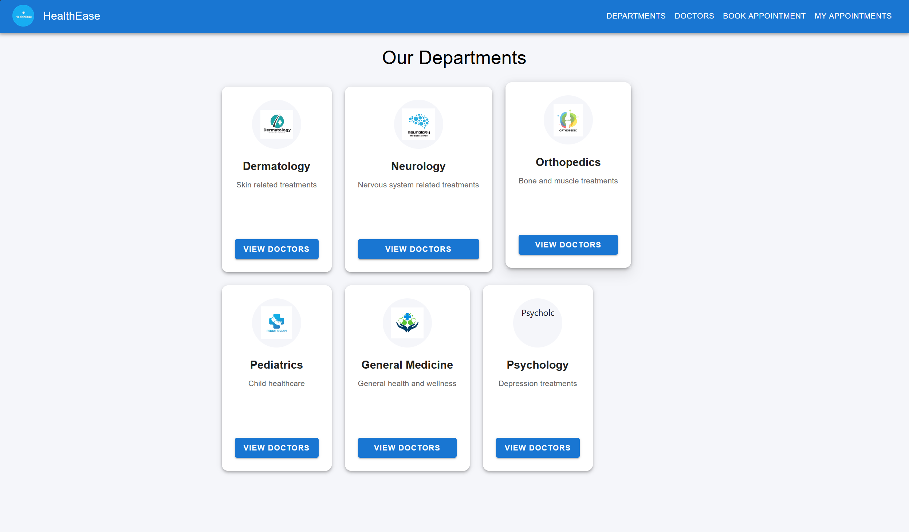
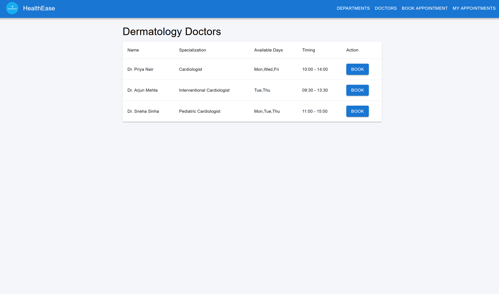
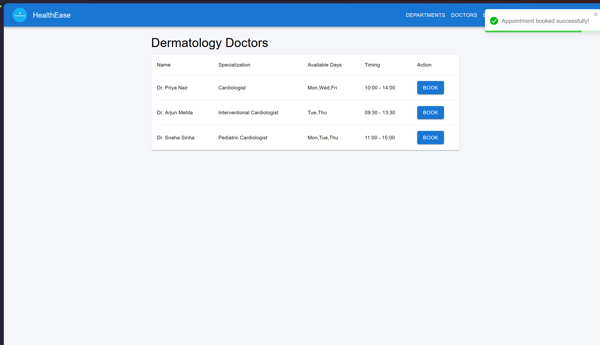

# HealthEase – Healthcare Management System

HealthEase is a college full-stack healthcare management project built with React, Node.js, Express, and MySQL. It connects department discovery, doctor availability, patient registration, and appointment booking through a React interface and a REST API.

Maintained by Sangat Singh from collaboratively developed work. See [attribution and licensing notes](docs/ATTRIBUTION.md).

## Problem statement and objectives

Finding a suitable doctor and coordinating appointment times can require repeated manual communication. HealthEase provides a single interface to explore departments, see doctor schedules, and submit appointment requests. The project demonstrates component-based UI development, layered backend design, relational modeling, parameterized SQL, and frontend/API integration.

Objectives include reducing booking steps, displaying available time slots, associating patients with appointments, and tracking appointment and payment status in a relational database.

## Implemented features

- Browse departments with illustrations and animated cards.
- View all doctors or filter doctors by department; display specialization, available days, and working hours.
- Book through a dedicated form or a doctor-specific dialog; create a patient record before creating the appointment.
- Generate 30-minute slots from doctor working hours and filter out slots returned by the booked-slot API.
- Search appointments by email in the browser and display doctor, department, date, time, booking status, and payment status.
- Cancel appointments and mark their payment status as paid through PATCH routes. Pay Now records a status change only; it does not collect money.
- Provide backend list/create endpoints for departments, doctors, patients, appointments, and payment records.
- Enforce unique doctor/date/time bookings and appointment working hours through the verified database constraint and trigger.
- Display success/error notifications with React Toastify.

Payment handling consists of stored records and a payment-status action. No payment gateway or actual money transfer is integrated. There is no login, role-based access control, or patient authorization. Use synthetic data for demonstrations.

## Technology stack

| Layer | Technologies used |
| --- | --- |
| Frontend | React 19, Create React App (`react-scripts` 5), JavaScript, Material UI 7, Emotion, CSS |
| Interaction | Axios, Framer Motion, React Toastify |
| Backend | Node.js, Express 4, CORS middleware, dotenv |
| Database | MySQL 8.0, `mysql2/promise`, connection pool, parameterized queries |
| Development | npm lockfiles, Nodemon, Jest/React Testing Library through react-scripts |

`react-chatbotify` is declared as a dependency but is not integrated into the application UI.

## Architecture

```text
React pages -> Axios services -> Express routes -> Controllers -> Models -> MySQL pool
```

The frontend uses React state in `App.js` to switch between pages; it does not use a URL router. `src/services/api.js` centralizes HTTP calls to `http://localhost:5000/api`.

The backend mounts resource routers under `/api`. Controllers validate required fields and handle HTTP responses; models perform asynchronous SQL queries through the shared MySQL connection pool. The slots and appointment PATCH handlers query the pool directly.

## Project structure

```text
HealthEase/
├── config/
│   └── db.js                     # Environment-driven MySQL pool
├── controllers/                  # HTTP handlers for six resources
├── models/                       # SQL access for five entities
├── routes/                       # Express routers
├── database/
│   ├── healthease.sql            # Verified schema and synthetic demo rows
│   └── README.md                 # Import/export instructions
├── docs/
│   ├── VALIDATION.md             # Preparation checks and known issues
│   ├── PUBLISHING.md             # Historical initial publication manifest
│   ├── ATTRIBUTION.md            # Collaborative origin and licensing notes
│   └── screenshots/             # Local application screenshots
├── healthease-frontend/
│   ├── public/                   # HTML shell, branding, department images
│   ├── src/
│   │   ├── pages/                # Departments, Doctors, BookAppointment, MyAppointments
│   │   ├── services/api.js       # Axios API functions
│   │   ├── App.js                # Navigation and page composition
│   │   └── App.test.js            # Existing starter test
│   ├── package.json
│   └── package-lock.json
├── .env.example
├── .gitignore
├── tests/                        # Isolated appointment PATCH route tests
├── package.json
├── package-lock.json
└── server.js                     # API entry point
```

## Database design

The verified schema includes these tables used by the application:

| Table | Main fields and relationships |
| --- | --- |
| `departments` | `id`, `name`, `description` |
| `doctors` | `id`, `name`, `department_id` → departments, `specialization`, `available_days`, `start_time`, `end_time` |
| `patients` | `id`, `full_name`, unique `email`, `phone`, `created_at` |
| `appointments` | `id`, `patient_id` → patients, `doctor_id` → doctors, `appointment_date`, `time_slot`, `status`, `payment_status`, `created_at` |
| `payments` | `id`, `appointment_id` → appointments, `amount`, `method`, `transaction_id`, `status`, `created_at` |

One department can have many doctors; a patient or doctor can have many appointments; an appointment can have multiple payment rows under the current schema. Foreign keys enforce the relationships. Appointments have a unique `(doctor_id, appointment_date, time_slot)` key and doctor/date and patient indexes. Doctors and payments have relationship indexes.

The `validate_appointment_time` BEFORE INSERT trigger rejects times outside doctor working hours. The `todays_appointments` view joins booked appointments for the current date with patient and doctor names. Neither object was invented for this preparation; both were exported from the connected schema.

The source database also contains `department`, `doctor`, `patient`, `appointment`, and `payment` tables. Their definitions are preserved in the export, but the current application models do not query them. Full definitions, enum values, keys, and indexes are in [database/healthease.sql](database/healthease.sql).

## Requirements and installation

- Node.js and npm. Validation was performed with Node.js 22.15.0; use the included lockfiles for reproducible dependency installation.
- MySQL 8.0; the exported schema uses `utf8mb4_0900_ai_ci`.
- MySQL Workbench or the MySQL command-line client.
- Git.

Clone the repository and install dependencies in both directories:

```bash
git clone https://github.com/Sangat-Singh/HealthEase.git
cd HealthEase
npm ci
cd healthease-frontend
npm ci
cd ..
```

On Windows PowerShell systems that block `npm.ps1`, use `npm.cmd` for these commands.

### MySQL setup

Create a new, empty local database:

```sql
CREATE DATABASE healthease_demo
  CHARACTER SET utf8mb4 COLLATE utf8mb4_0900_ai_ci;
```

Import `database/healthease.sql` through Workbench: **Server → Data Import → Import from Self-Contained File**, choose the SQL file, select `healthease_demo` as the target, and start the import. For complete steps and safe export instructions, see [database/README.md](database/README.md).

Alternatively, open the MySQL client with a password prompt:

```bash
mysql -u your_local_mysql_user -p healthease_demo
```

Then run from the repository root:

```sql
SOURCE database/healthease.sql;
```

The import script contains object-drop statements. Use a new demo database. It includes only synthetic records, including `demo.patient@example.invalid`; no real patient records were exported.

### Environment configuration

Copy `.env.example` to `.env` in the repository root and set local values:

```dotenv
DB_HOST=localhost
DB_USER=your_local_mysql_user
DB_PASSWORD=replace_with_your_local_mysql_password
DB_NAME=healthease_demo
PORT=5000
```

`.env` is ignored by Git. Keep credentials out of source code and commits. The backend uses the default MySQL port, 3306; `DB_PORT` is not read by the existing configuration.

The frontend has no custom environment variables in the current implementation, so no frontend `.env.example` is needed. Its API URL is set in `healthease-frontend/src/services/api.js`. Keep backend port 5000 for the default setup; if changing it, update that URL as well. Never put credentials in frontend code or React environment variables.

### Start the application

Start MySQL first, then the backend, then the frontend. Keep both VS Code terminals open. The backend reads `PORT=5000` from the root `.env`; the frontend defaults to port **3000** and calls `http://localhost:5000/api`.

Terminal 1, PowerShell in the repository root:

```powershell
npm.cmd run dev
# Or: npm.cmd start
```

Terminal 2, a separate PowerShell terminal in the repository root:

```powershell
cd healthease-frontend
npm.cmd start
```

Open `http://localhost:3000`. Check the API at `http://localhost:5000/api/test`.

If the backend is already running on port 5000, reuse it or stop it in its original terminal with `Ctrl+C` before restarting. If React offers a different port because 3000 is busy, the browser URL will change. MySQL Workbench is a client; the MySQL server service must be running independently.

To build the frontend:

```bash
cd healthease-frontend
npm run build
```

The Express server does not serve the frontend build. Hosting the frontend and API requires separate deployment configuration.

## REST API

Base URL: `http://localhost:5000/api`. Send JSON bodies with `Content-Type: application/json`. List routes return arrays; create routes return HTTP 201 and the created ID. Missing required fields return HTTP 400; caught database errors return HTTP 500 with an error message.

| Method | Endpoint | Input / behavior |
| --- | --- | --- |
| GET | `/test` | Returns an API status message; does not check database health |
| GET | `/departments` | Lists departments |
| POST | `/departments` | Required: `name`; optional: `description` |
| GET | `/doctors` | Lists doctors with department name |
| POST | `/doctors` | Required: `name`, `department_id`; other fields: `specialization`, `available_days`, `start_time`, `end_time` |
| GET | `/patients` | Lists patients |
| POST | `/patients` | Required: `full_name`, `email`, `phone` |
| GET | `/appointments` | Lists all appointments with patient name/email, doctor, specialization, and department |
| POST | `/appointments` | Required: `patient_id`, `doctor_id`, `appointment_date`, `time_slot`; optional: `status` (defaults to `booked`), `payment_status` (defaults to `pending`) |
| PATCH | `/appointments/:id/cancel` | Sets status to `cancelled` |
| PATCH | `/appointments/:id/payment` | Body: `payment_status`; frontend sends `paid` |
| GET | `/payments` | Lists payment records joined with appointment, patient, and doctor details |
| POST | `/payments` | Required: `appointment_id`, nonzero `amount`, `method`, `status`; optional: `transaction_id` |
| GET | `/slots?doctor_id=1&appointment_date=2030-01-15` | Both query parameters required; returns an array of booked time strings |

Use `YYYY-MM-DD` dates and `HH:mm:ss` times. Database enums are appointment status `booked/completed/cancelled`, payment status `paid/pending`, payment method `online/cod`, and payment record status `success/failed/pending`. `available_days` is a MySQL SET of `Mon,Tue,Wed,Thu,Fri,Sat,Sun`.

Example booking body, using the synthetic patient and doctor from the import:

```json
{
  "patient_id": 1,
  "doctor_id": 1,
  "appointment_date": "2030-01-15",
  "time_slot": "09:30:00",
  "status": "booked",
  "payment_status": "pending"
}
```

The API does not accept an email filter for appointments: the frontend fetches the full list and filters it locally. The create-appointment response echoes supplied status fields, so omitted status fields may be absent from the response even though database defaults were applied by the controller.

## Validation and known issues

Run backend checks from the repository root with `npm.cmd test`. The tests exercise successful and failed cancellation/payment HTTP requests against a mocked pool, without connecting to MySQL or changing records. Build the frontend with `npm.cmd run build` inside `healthease-frontend`. Preparation checks and their limits are recorded in [docs/VALIDATION.md](docs/VALIDATION.md).

- Backend JavaScript syntax checks and the frontend production build passed.
- The existing frontend test suite fails on Axios ES module parsing before executing any tests. Its starter assertion also expects a removed “learn react” link.
- Patient creation and appointment creation are separate requests. A failed booking may leave a patient row; booking again with the same email can fail on the unique email key.
- Booked-slot queries include cancelled appointments, and the unique slot constraint also applies to cancelled bookings.
- Available days are displayed but not enforced during booking. Slot filtering in the browser does not prevent simultaneous requests; the database unique key prevents duplicate slots.
- There is no authentication or authorization. Appointment search by email is a convenience filter, not access control. CORS currently permits all origins.
- Pay Now does not create a payment record or invoke a gateway.
- PATCH handlers do not validate allowed status transitions or check whether the appointment ID exists.
- The supplied local screenshots show demo catalog inconsistencies (for example, specializations that do not match the selected department). Catalog data should be reviewed before a demonstration.

The missing database-pool import in the appointment PATCH controller has been fixed. These remaining limitations are documented for follow-up; live database mutation flows were not exercised during this update.

## Screenshots

The following screenshots were supplied from a successful local demonstration of department browsing, doctor listing, and booking confirmation. They show the local catalog, which can differ from the synthetic SQL seed.

### Departments



### Doctors



### Appointment booking confirmation



The supplied appointment-history screenshot was omitted because it contains an email address and appointment details not confirmed to be synthetic. To add one, capture history using only synthetic patient/contact and appointment data, save it as `docs/screenshots/appointment-history.png`, and review it before publishing.

## Future improvements

- Validate allowed appointment status transitions and affected rows.
- Replace the starter test with meaningful UI tests and add API integration tests against an isolated test database.
- Add authentication, patient authorization, and staff roles before using private records.
- Validate doctor working days, handle cancelled slot reuse, and use transactional booking with patient lookup/reuse.
- Add a real payment integration with server-side verification if payment collection is required.
- Make the API URL configurable, restrict deployment CORS, and add deployment configuration and CI checks.
